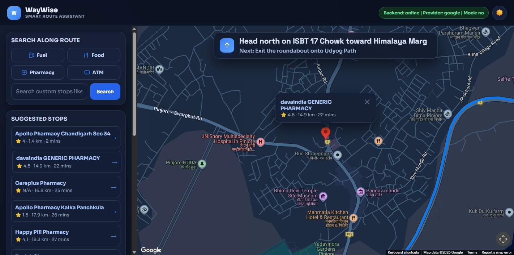
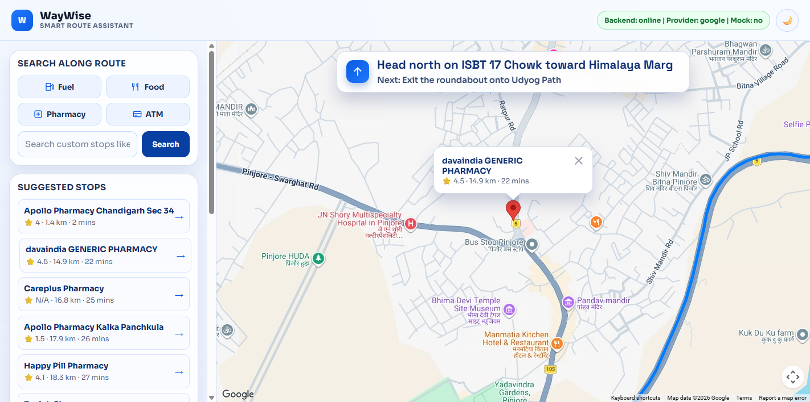

# WayWise

**Find stops along your route, not just near you.**

WayWise is a navigation assistant for road trips. Give it an origin and a destination, and it
finds fuel, food, pharmacies, ATMs or anything you type *along the way*. It then ranks them by how
long the detour actually takes and whether the stop is still ahead of you.

**Live app:** https://www.waywiseapp.tech

**Demo video (Google Maps Platform version):** https://youtu.be/StoE0CNFRbw

[](https://youtu.be/StoE0CNFRbw)

## Features

- **Stops along the route.** Quick searches for Fuel, Food, Pharmacy and ATM, plus a free-text
  search for anything else. Results are pins on the map and a ranked list beside it.
- **Ranked by detour time, not distance.** Stops are ranked by drive time from your live position.
  A stop you have already passed gets a 15-minute penalty, so the ones still ahead of you come first.
- **Live navigation.** Your GPS position follows the route with a heading arrow, and the current
  and next turn instructions stay pinned above the map.
- **Convoy mode.** Create a room, share the code, and everyone in the convoy sees each other's live
  position on the map.
- **Two map providers.** It runs on open map data by default and can switch to Google Maps Platform
  with one setting. If a Google call fails it falls back to the open data automatically.
- **Light and dark themes**, and a layout that turns into a bottom sheet on phones.

<details>
<summary>Light theme</summary>



</details>

## How a stop search works

1. **Route.** The route comes back as a polyline plus turn-by-turn steps.
2. **Candidates.** Up to 8 points are sampled along the route, and places matching the search are
   looked up around each one.
3. **On the route.** Places further than 1.5 km from every point of the route are dropped.
4. **Ahead of you.** Each stop is matched to its nearest point on the route. Stops behind your
   current position get the backtrack penalty.
5. **Ranking.** Drive times from your position to every candidate come from one matrix call. The
   best 8 are returned. If the matrix service is unavailable, a straight-line estimate is used
   instead.

Routes, candidates, ranked results and geocoding are cached in memory with time limits and size
caps, so repeat searches don't call the upstream services again.

## Map providers

Set `WAYWISE_MAP_PROVIDER` to choose one.

| | `free` (default, used by the live app) | `google` |
|---|---|---|
| Route and turn-by-turn | OSRM | Routes API `computeRoutes` |
| Geocoding | Nominatim, falling back to Photon | (Routes API takes addresses directly) |
| Places along the route | Overpass API | Places API (New) Text Search |
| Ranking by drive time | OSRM Table | Routes API `computeRouteMatrix` |
| Map | Leaflet with OpenStreetMap tiles | Maps JavaScript API with Advanced Markers |

In Google mode the frontend draws on a Google map, because Google's terms require Google route and
place results to be shown on one. With `WAYWISE_ENABLE_GOOGLE_FALLBACK=true` (the default), a
failed Google route or place search falls back to the free provider, so the app keeps working.

On a Chandigarh to Shimla test route, a stop search on the Google stack returned in about a
second and found 8 pharmacies along the way. The open-data version took around 5 seconds and found 1.

## Running it locally

Developed and tested on Python 3.11.

```bash
git clone https://github.com/krishnagandhicode/waywise-app.git
cd waywise-app
python -m venv venv
venv\Scripts\activate          # macOS/Linux: source venv/bin/activate
pip install -r requirements.txt
python app.py
```

Open http://127.0.0.1:5000. Flask serves both the API and the frontend, so there is no separate
frontend build.

**No network or keys?** Set `WAYWISE_MOCK_MODE=true` to get deterministic routes and stops with no
external calls.

### Google mode

1. In Google Cloud, enable **Routes API**, **Places API (New)** and **Maps JavaScript API**.
2. Create two keys: a server key limited to Routes API and Places API (New), and a browser key
   limited to the Maps JavaScript API and to your site's address.
3. Add them to a `.env` file in the project root:

```env
WAYWISE_MAP_PROVIDER=google
GOOGLE_MAPS_API_KEY=your-server-key
GOOGLE_MAPS_JS_API_KEY=your-browser-key
```

The server key is only ever used on the server. The page receives the browser key and nothing else.

## Configuration

All settings are environment variables, read from `.env` if present.

| Variable | Default | What it does |
|---|---|---|
| `WAYWISE_MAP_PROVIDER` | `free` | `free` or `google` |
| `WAYWISE_ENABLE_GOOGLE_FALLBACK` | `true` | Fall back to the free provider when Google fails |
| `WAYWISE_MOCK_MODE` | `false` | Serve deterministic data without calling any external API |
| `GOOGLE_MAPS_API_KEY` | | Server key for Routes API and Places API (New) |
| `GOOGLE_MAPS_JS_API_KEY` | | Browser key for the Maps JavaScript API |
| `GOOGLE_MAPS_MAP_ID` | `DEMO_MAP_ID` | Map ID for the Google map |
| `GOOGLE_LANGUAGE_CODE` | `en` | Language for Google turn-by-turn steps and place names |
| `GOOGLE_MAX_SEARCH_POINTS` | `8` | Route points searched for places on Google (bounds billed calls) |
| `GOOGLE_PLACES_MAX_PARALLEL` | `4` | How many Google place searches run at once |
| `DISTANCE_MATRIX_MAX_DESTINATIONS` | `25` | Stops ranked per matrix request |
| `FREE_MAX_SEARCH_POINTS` | `8` | Route points searched on Overpass |
| `CACHE_MAX_ENTRIES` | `500` | Size cap for each in-memory cache |
| `WAYWISE_ALLOWED_ORIGINS` | | Comma-separated origins allowed by CORS. Empty means none, which is right when Flask serves the frontend |
| `PORT` | `5000` | Port for `python app.py` |

`GOOGLE_MAX_SEARCH_POINTS` and `DISTANCE_MATRIX_MAX_DESTINATIONS` decide how many billed Google
calls one search can make, so lower them before putting a public deployment on Google.

## Tests

```bash
pip install -r requirements-dev.txt
pytest
```

The 142 tests run offline: every external service is replaced with canned responses in the shape
of the real API. They cover the stop pipeline, Google's Routes and Places (New) response formats,
every fallback, and the caps on billed call volume.

## Deploying

The live app runs as a single [Render](https://render.com) web service, configured in
`render.yaml`:

- Build: `pip install -r requirements.txt`
- Start: `gunicorn app:app`
- Environment: `WAYWISE_MAP_PROVIDER=free`, `WAYWISE_MOCK_MODE=false`

Convoy rooms are kept in memory, so they reset when the service restarts.

## Project structure

```text
waywise-app/
├── app.py                      # Launcher, so `gunicorn app:app` works
├── backend/
│   └── app.py                  # Flask API: providers, stop pipeline, caches, convoy
├── frontend/
│   ├── templates/index.html
│   └── static/
│       ├── css/style.css
│       └── js/
│           ├── script.js       # App entry: trip flow, live tracking, convoy
│           └── modules/
│               ├── map.js      # Map view interface + Leaflet renderer
│               ├── google-map.js  # Google Maps renderer (Google mode)
│               ├── convoy.js   # Convoy members and markers
│               ├── api.js      # Fetch helpers
│               └── toast.js    # Notifications
├── tests/                      # pytest suite
└── render.yaml                 # Render deployment
```

## Roadmap

- **Conversational assistant.** A real tool-using assistant that can plan stops from a
  sentence ("find a pharmacy before Shimla that's open now"). Today `/chat` only matches keywords.
- **Proactive warnings**, such as a long stretch ahead with no fuel.
- **Persistent convoy rooms** that survive a restart.

## License

Copyright (c) 2026 Krishna Gandhi. All rights reserved. WayWise is a trademark of Krishna Gandhi.
See [LICENSE](LICENSE). No permission is granted for reuse, redistribution or derivative work
without written approval.
